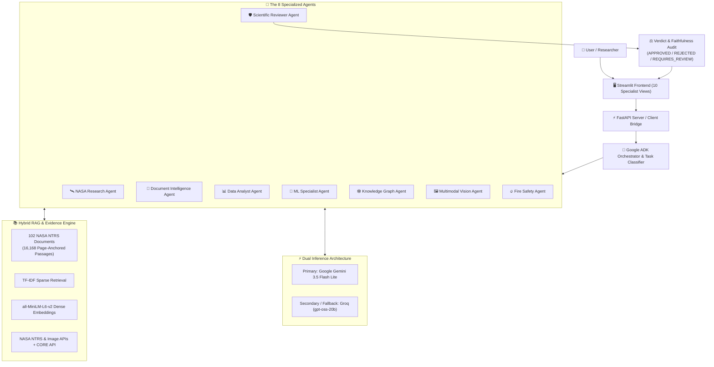

# 🚀 IGNIS — Space Combustion Intelligence
### NASA Space Apps Challenge 2026 · Team RaoSpace Labs

[](https://ignis-space.streamlit.app/)
[](https://ignis-backend-nxe9.onrender.com)

**🌐 Live Web Application:** [https://ignis-space.streamlit.app/](https://ignis-space.streamlit.app/)  
**⚡ Cloud Backend API (Render):** [https://ignis-backend-nxe9.onrender.com](https://ignis-backend-nxe9.onrender.com)

---

[](https://www.python.org/)
[](https://github.com/google/adk)
[](https://aistudio.google.com/)
[](https://groq.com/)
[](https://fastapi.tiangolo.com/)
[](https://streamlit.io/)
[](tests/)

> **IGNIS** is an evidence-first, multi-agent AI system designed to accelerate research in **microgravity fire safety and spacecraft combustion physics**. It orchestrates 8 specialized agents over **102 NASA technical reports (16,168 page-anchored evidence passages)**, external NASA open APIs, and real experimental datasets.

---

## 📌 Table of Contents

- [Overview & The Problem](#-overview--the-problem)
- [System Architecture](#-system-architecture)
- [Technology Stack](#-technology-stack)
- [The 8 Specialist Agents](#-the-8-specialist-agents)
- [The 7 Multi-Agent Workflows](#-the-7-multi-agent-workflows)
- [Interactive Frontend (10 Views)](#-interactive-frontend-10-views)
- [Quickstart & Installation](#-quickstart--installation)
- [Verification & Tests](#-verification--tests)
- [Deployment (Render)](#-deployment-render)
- [Scientific Honesty & Integrity](#-scientific-honesty--integrity)
- [Team RaoSpace Labs](#-team-raospace-labs)

---

## 🌌 Overview & The Problem

Fire in microgravity behaves fundamentally differently than on Earth:
- **No Natural Buoyancy:** In $0\text{g}$, warm combustion products do not rise. Flames become spherical, dim, and blue.
- **Radiative Quenching:** Without buoyant air currents, combustion products linger, starving the flame of oxygen or cooling it until radiative extinction occurs.
- **Hidden Smoldering:** Low ventilation ducts can sustain low-temperature smoldering combustion that goes undetected by conventional smoke detectors.
- **Terrestrial Standards Fail:** Standard terrestrial material flammability tests (e.g., NASA-STD-6001 Test 1) often underestimate microgravity persistence in low-speed forced ventilation.

**The Solution:** IGNIS bridges decades of NASA flight experiments (**BASS, BASS-II, FLEX, ACME, SAFFIRE, SAME, CIR**) with modern agentic AI to answer complex microgravity combustion questions, extract experimental conditions, compare spaceflight campaigns, and validate scientific claims with page-anchored evidence.

---

## 🏗️ System Architecture



---

## 🛠️ Technology Stack

Aligned with the official NASA Space Apps Challenge presentation:

| Layer | Technology | Role |
|---|---|---|
| **Frontend** | Streamlit, Plotly, Altair, Graphviz | 10 interactive views, dark NASA-inspired theme |
| **Backend API** | FastAPI, Uvicorn, Python 3.13 | High-performance RESTful AI endpoints |
| **Agent Framework** | Google Agent Development Kit (ADK) 2.0 | Multi-agent coordination, sessions, tool binding |
| **Primary LLM** | Google Gemini 3.5 Flash Lite | High-reasoning agent inference & vision |
| **Secondary LLM** | Groq (`openai/gpt-oss-20b`) | Ultra-fast token generation & secondary fallback |
| **Embeddings & RAG** | Sentence-Transformers (`all-MiniLM-L6-v2`), Scikit-learn | Dense + Sparse hybrid retrieval (weight: 0.6) |
| **Data & Scientific** | NumPy, Pandas, SciPy, PyMuPDF | Deterministic statistics, correlation, metrics |
| **Evaluation** | Pytest, Pytest-asyncio, Goldset harness | 87 automated unit tests + 30-item gold benchmark |

---

## 🤖 The 8 Specialist Agents

| Agent | Icon | Responsibilities | Key Tools |
|---|:---:|---|---|
| **NASA Research** | 🛰️ | Searches NASA Technical Report Server (NTRS) and imagery | `search_nasa_technical_reports`, `retrieve_investigation_metadata` |
| **Document Intelligence** | 📄 | Hybrid literature search over 102 ingested NASA papers | `search_scientific_literature`, `extract_experimental_conditions` |
| **Data Analyst** | 📊 | Deterministic statistical analysis (no LLM math errors) | `calculate_descriptive_statistics`, `compute_correlation_matrix` |
| **Machine Learning** | 🧠 | Evaluates dataset suitability for ML and model metrics | `assess_dataset_ml_suitability`, `evaluate_model_metrics` |
| **Knowledge Graph** | 🕸️ | Extracts entities and typed relationships from texts | `extract_entities`, `extract_relationships`, `build_graph` |
| **Multimodal Vision** | 🖼️ | Analyzes scientific charts, axes, legends, and curves | `analyze_scientific_figure` (Gemini Vision) |
| **Fire Safety** | 🔥 | Assesses spacecraft hazards and identifies evidence gaps | `assess_mission_relevance`, `identify_safety_evidence_gaps` |
| **Scientific Reviewer** | 🛡️ | Audits generated claims against retrieved evidence | `review_scientific_claims`, `validate_citations` |

---

## 🔄 The 7 Multi-Agent Workflows

IGNIS automatically classifies queries into one of 7 specialized routing topologies:

- **Workflow A (Research Discovery):** `NASA Research` → `Scientific Reviewer`
- **Workflow B (Experiment Comparison):** `NASA Research` → `Document Intelligence` → `Data Analyst` → `Scientific Reviewer`
- **Workflow C (ML Suitability):** `Data Analyst` → `ML Specialist` → `Scientific Reviewer`
- **Workflow D (Scientific Question):** `NASA Research` → `Document Intelligence` → `Fire Safety` → `Scientific Reviewer`
- **Workflow E (Knowledge Graph):** `Document Intelligence` → `Knowledge Graph` → `Scientific Reviewer`
- **Workflow F (Figure Analysis):** `Multimodal Vision` → `Document Intelligence` → `Scientific Reviewer`
- **Workflow G (Statistical Analysis):** `Data Analyst` → `Scientific Reviewer`

---

## 🖥️ Interactive Frontend (10 Views)

The Streamlit interface ([**https://ignis-space.streamlit.app/**](https://ignis-space.streamlit.app/)) provides 10 dedicated workstations :

1. **Home:** Overview banner, corpus metrics (102 docs / 16,168 chunks), workflow cards, quick-start query launchers.
2. **Ask IGNIS:** Real-time multi-agent execution with streaming thought logs, timeline, and final reviewed answer.
3. **Research:** Live queries across NASA Technical Reports Server (NTRS) and image galleries with thumbnail previews.
4. **Documents:** PDF document intelligence; extracts ambient pressure, oxygen %, flow speed, and materials.
5. **Data & ML:** Descriptive statistics, missing-value analysis, group comparison, Pearson correlation heatmaps, ML suitability checks, and model performance metrics (Accuracy, F1, ROC-AUC).
6. **Knowledge Graph:** Converts scientific text into interactive Graphviz concept maps (colored by entity type: Investigation, Material, Facility, Phenomenon, Condition).
7. **Figures:** Scientific chart reader powered by Gemini Vision; extracts axes, labels, data trends, and experimental limitations.
8. **Fire Safety:** Spacecraft mission relevance audits (ISS, Gateway, Lunar, Mars) and safety evidence gap detection.
9. **Reviewer:** Standalone scientific auditor; tests claims against evidence with citation validation.
10. **System:** Live telemetry, active provider order, cache stats, model latency, and diagnostics.

---

## ⚡ Quickstart & Installation

### 1. Prerequisites
- **Python 3.13+** installed on your system.
- Git.

### 2. Clone the Repository
```bash
git clone https://github.com/ilefSaadaoui/IGNIS.git
cd IGNIS
```

### 3. Create & Activate a Virtual Environment
```bash
# Windows (PowerShell)
python -m venv .venv
.\.venv\Scripts\Activate.ps1

# Linux / macOS
python3 -m venv .venv
source .venv/bin/activate
```

### 4. Install Dependencies
```bash
pip install -r requirements.txt
```

### 5. Configure Environment Variables
Copy the `.env.example` file to `backend/ignis_adk/.env`:
```bash
# Windows (PowerShell)
Copy-Item .env.example backend/ignis_adk/.env

# Linux / macOS
cp .env.example backend/ignis_adk/.env
```
Open `backend/ignis_adk/.env` and add your free API keys:
- **`GOOGLE_API_KEY`**: Free key from [Google AI Studio](https://aistudio.google.com/app/apikey) *(Required for primary agents & vision)*
- **`GROQ_API_KEY`**: Free key from [Groq Console](https://console.groq.com/keys) *(Optional secondary provider)*
- **`NASA_API_KEY`**: Free key from [NASA Open APIs](https://api.nasa.gov/) *(Required for live NTRS calls)*

### 6. Run the Servers

#### Terminal 1 — Start the Backend (FastAPI):
```bash
cd backend/ignis_adk
python -m uvicorn server:app --host 127.0.0.1 --port 8000 --reload
```
*API documentation available at `http://127.0.0.1:8000/docs`*

#### Terminal 2 — Start the Frontend (Streamlit):
```bash
cd frontend
python -m streamlit run app.py --server.port 8501
```
*Web application available at `http://localhost:8501` (or live at [https://ignis-space.streamlit.app/](https://ignis-space.streamlit.app/))*

---

## 🧪 Verification & Tests

### Automated Integration Audit
Run the comprehensive 7-task integration test from the repository root:
```bash
python integration_audit.py
```
Expected output:
```text
======================================================================
  IGNIS — INTEGRATION AUDIT REPORT
======================================================================
✅ PASS  TASK 1 - Backend APIs connected
✅ PASS  TASK 2 - Data flow (corpus: 102 docs | 16168 chunks | embeddings=True)
✅ PASS  TASK 2 - Workflow routing
✅ PASS  TASK 3 - Corpus API
✅ PASS  TASK 4 - All 8 agents importable
✅ PASS  TASK 4 - All 10 frontend views loaded
✅ PASS  TASK 5 - FastAPI server + AI endpoints (8 routes)
======================================================================
  RESULT: 7/7 tasks passed
======================================================================
```

### Unit Tests
Run the pytest test suite (87 tests):
```bash
cd backend/ignis_adk
python -m pytest tests/ -q
```

---

## 🌐 Deployment & Live Links

- **Frontend (Streamlit Cloud):** [https://ignis-space.streamlit.app/](https://ignis-space.streamlit.app/)
- **Backend API (Render):** [https://ignis-backend-nxe9.onrender.com](https://ignis-backend-nxe9.onrender.com)
  - Health check: `GET /health` → `{"status": "healthy", "service": "IGNIS Space Combustion Intelligence"}`

The backend is configured for deployment on [Render](https://render.com/) via [`backend/ignis_adk/render.yaml`](backend/ignis_adk/render.yaml):
- **Root Directory:** `backend/ignis_adk`
- **Build Command:** `pip install -r requirements.txt`
- **Start Command:** `uvicorn server:app --host 0.0.0.0 --port $PORT`
- **Health Check Path:** `/health`
- **Environment Variables:** Set `GOOGLE_API_KEY`, `GROQ_API_KEY`, `NASA_API_KEY`, and `IGNIS_PROVIDER_ORDER=gemini,groq`.

---

## ⚖️ Scientific Honesty & Integrity

1. **Deterministic Calculations:** All statistical formulas, metrics, and correlations are computed with NumPy/Pandas/Scikit-learn — never estimated by language models.
2. **Page-Anchored Citations:** Every literature citation includes the NASA document title, official NTRS URL, and verified page number.
3. **Mandatory Limitations:** When an answer lacks direct evidence, IGNIS surfaces explicit warnings instead of filling gaps with ungrounded speculation.
4. **Honesty Contract:** IGNIS is an AI research assistant designed to assist scientists and engineers. It does **not** certify spaceflight hardware or replace official NASA flight safety boards.

---

## 👥 Team RaoSpace Labs

Developed for the **NASA Space Apps Challenge 2026** by **Team RaoSpace Labs**

*IGNIS — Space Combustion Intelligence · Powered by NASA Open Data & Google Agent Development Kit.*
