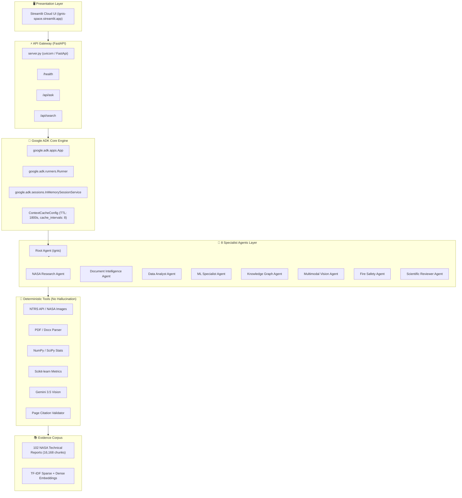
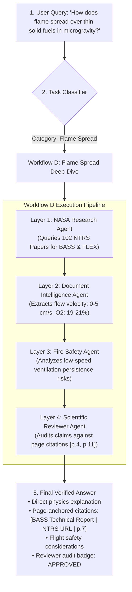

# 🚀 IGNIS Backend Architecture & Google ADK Guide
### Team RaoSpace Labs · NASA Space Apps Challenge 2026

This document presents the complete architectural breakdown of the **IGNIS** backend, detailing how **Google ADK (Agent Development Kit)** orchestrates the 8 specialist agents, how they communicate through shared sessions, and the exact query execution flow.

---

## 📸 Architectural Visuals


*Figure 1: IGNIS Backend System Architecture & Layer Organization*


*Figure 2: Google ADK Root Agent & 8 Specialist Sub-Agents Topology*


*Figure 3: Agent Communication & Shared In-Memory Session State Pipeline*


*Figure 4: End-to-End Query Lifecycle: From Ingestion to Scientific Reviewer Verdict*

---

## 1. 🏗️ Backend Organization (Architecture Overview)

The backend is organized into cleanly separated layers:

```
backend/ignis_adk/
├── server.py                        # FastAPI Server: REST endpoints (/api/ask, /api/search, /health)
├── ignis/
│   ├── agent.py                     # Google ADK App entrypoint (App, ContextCacheConfig)
│   ├── agents/                      # 8 Specialist Agents + Root Orchestrator
│   │   ├── root_agent.py            # Root Agent (`ignis`): high-level routing & delegation
│   │   ├── nasa_research_agent.py   # NASA NTRS API & literature discovery
│   │   ├── document_intelligence_agent.py # Document parsing & conditions extraction
│   │   ├── data_analyst_agent.py    # Deterministic statistical calculations
│   │   ├── ml_agent.py              # ML suitability & evaluation
│   │   ├── knowledge_graph_agent.py # Concept map & Graphviz extraction
│   │   ├── multimodal_agent.py      # Gemini Vision scientific chart interpretation
│   │   ├── fire_safety_agent.py     # Spacecraft exploration safety & evidence gaps
│   │   └── scientific_reviewer_agent.py # Audit gate: claim verification & citation validation
│   ├── orchestration/
│   │   ├── routing.py               # 7 Workflows (A through G) & task classifier
│   │   └── workflows.py             # ADK Runner execution pipeline & step logging
│   ├── tools/                       # Deterministic Python functions wrapped in FunctionTool
│   ├── corpus/                      # 102 NASA NTRS papers, 16,168 page-anchored passages (TF-IDF)
│   ├── context/                     # ContextBuilder, ConversationSummarizer, TokenManager
│   └── sessions/                    # InMemorySessionService & state durability
```



---

## 2. 🤖 Google ADK Integration & Agent Definitions

### A. The Top-Level App Entrypoint ([`backend/ignis_adk/ignis/agent.py`](file:///C:/Users/hp/Downloads/IGNIS_Final/backend/ignis_adk/ignis/agent.py#L1-L16))

Google ADK 2.x discovers the application through the `App` object:

```python
from google.adk.apps import App
from google.adk.agents.context_cache_config import ContextCacheConfig
from ignis.agents.root_agent import root_agent

# ADK 2.x App wrapper with context caching for token optimization
app = App(
    name="ignis",
    root_agent=root_agent,
    context_cache_config=ContextCacheConfig(
        cache_intervals=8, 
        ttl_seconds=1800, 
        min_tokens=1024
    ),
)
```

### B. The Root Agent and Sub-Agents Declaration ([`backend/ignis_adk/ignis/agents/root_agent.py`](file:///C:/Users/hp/Downloads/IGNIS_Final/backend/ignis_adk/ignis/agents/root_agent.py#L92-L112))

The Root Agent is an instance of `google.adk.agents.LlmAgent`. It owns the 8 specialist sub-agents:

```python
from google.adk.agents import LlmAgent

root_agent = LlmAgent(
    name="ignis",
    description="Root Research Orchestrator for IGNIS — routes scientific questions...",
    model=build_groq_model("default"),
    instruction=INSTRUCTION,
    sub_agents=[
        nasa_research_agent,
        document_intelligence_agent,
        data_analyst_agent,
        ml_agent,
        knowledge_graph_agent,
        multimodal_agent,
        fire_safety_agent,
        scientific_reviewer_agent,
    ],
    generate_content_config=content_config(temperature=0.2),
    timeout=180,
)
```

### C. Specialist Agent & Tool Binding ([`backend/ignis_adk/ignis/agents/nasa_research_agent.py`](file:///C:/Users/hp/Downloads/IGNIS_Final/backend/ignis_adk/ignis/agents/nasa_research_agent.py#L52-L71))

Each specialist binds deterministic Python functions using `google.adk.tools.FunctionTool`:

```python
from google.adk.agents import LlmAgent
from google.adk.tools import FunctionTool

nasa_research_agent = LlmAgent(
    name="nasa_research_agent",
    description="Discovers and retrieves genuine NASA combustion-research metadata...",
    model=build_groq_model("default"),
    instruction=INSTRUCTION,
    tools=[
        FunctionTool(search_scientific_literature),
        FunctionTool(search_core_research),
        FunctionTool(search_nasa_research),
        FunctionTool(retrieve_investigation_metadata),
        FunctionTool(search_nasa_images),
        FunctionTool(extract_research_source),
    ],
    generate_content_config=content_config(temperature=0.1),
    timeout=90,
)
```

---

## 3. 💬 Agent Communication & Shared State

In Google ADK, agents do not make unmonitored peer-to-peer network calls. Instead, they communicate through a **Shared In-Memory Session** managed by `google.adk.sessions.InMemorySessionService`:

```mermaid
sequenceDiagram
    autonumber
    actor User as User / UI
    participant Orch as Workflow Orchestrator
    participant Session as InMemorySessionService
    participant CBuilder as ContextBuilder
    participant Spec1 as Specialist 1 (e.g. Data Analyst)
    participant Spec2 as Specialist 2 (e.g. NASA Research)
    participant Reviewer as Scientific Reviewer

    User->>Orch: Submit Question
    Orch->>Session: create_session(sid, app_name="ignis")
    
    rect rgb(20, 30, 45)
        Note over Orch,Spec1: Layer 1: Deterministic Analysis
        Orch->>CBuilder: Build context for Specialist 1
        CBuilder-->>Spec1: Clean prompt + numerical payload
        Spec1->>Spec1: Executes calculate_descriptive_statistics()
        Spec1->>Session: Append Step Log & Findings to state
    end

    rect rgb(30, 40, 60)
        Note over Orch,Spec2: Layer 2: Literature Retrieval
        Orch->>CBuilder: Gather findings from Session state
        CBuilder-->>Spec2: Inject findings + query NTRS corpus
        Spec2->>Spec2: search_scientific_literature() -> returns [p.4, p.11]
        Spec2->>Session: Append retrieved papers & excerpts
    end

    rect rgb(45, 25, 25)
        Note over Orch,Reviewer: Layer 3: Independent Review Gate
        Orch->>Reviewer: Draft answer + raw evidence citations
        Reviewer->>Reviewer: validate_citations() & review_scientific_claims()
        Reviewer-->>Orch: Verdict: APPROVED with grounded citations
    end

    Orch-->>User: Return Verified Answer with Page Anchors
```



### Context Pipeline (`ContextBuilder` & `ConversationSummarizer`)
1. **Sanitization:** `ContextBuilder` extracts only relevant scientific data, stripping internal tool errors and token bloat.
2. **Deterministic Handoff:** Specialist 1's mathematical output (e.g., $R^2 = 0.94$, $p < 0.001$) is injected as immutable context for Specialist 2.
3. **Audit Trail:** Every specialist step is timed with `time.perf_counter()` and recorded in `WorkflowStepLog(step, agent, status, output_excerpt, elapsed_seconds)`.

---

## 4. ⚡ End-to-End Query Execution Flow



---

## 5. 📂 Core Source Code Files in the Repository

| Component | File Path | Key Responsibilities |
| :--- | :--- | :--- |
| **ADK App Wrapper** | [`backend/ignis_adk/ignis/agent.py`](file:///C:/Users/hp/Downloads/IGNIS_Final/backend/ignis_adk/ignis/agent.py) | Top-level `App` and `ContextCacheConfig` definition |
| **Root Agent** | [`backend/ignis_adk/ignis/agents/root_agent.py`](file:///C:/Users/hp/Downloads/IGNIS_Final/backend/ignis_adk/ignis/agents/root_agent.py) | Master routing orchestrator & `sub_agents` registry |
| **Specialist Agents** | [`backend/ignis_adk/ignis/agents/`](file:///C:/Users/hp/Downloads/IGNIS_Final/backend/ignis_adk/ignis/agents/) | 8 specialist implementations (`LlmAgent`) |
| **Workflow Pipeline** | [`backend/ignis_adk/ignis/orchestration/workflows.py`](file:///C:/Users/hp/Downloads/IGNIS_Final/backend/ignis_adk/ignis/orchestration/workflows.py) | ADK `Runner` sequential execution & step logging |
| **Routing Topologies** | [`backend/ignis_adk/ignis/orchestration/routing.py`](file:///C:/Users/hp/Downloads/IGNIS_Final/backend/ignis_adk/ignis/orchestration/routing.py) | Workflows A through G classification heuristics |
| **Deterministic Tools** | [`backend/ignis_adk/ignis/tools/`](file:///C:/Users/hp/Downloads/IGNIS_Final/backend/ignis_adk/ignis/tools/) | NumPy stats, Gemini Vision, NTRS API callers |
| **NTRS Corpus Store** | [`backend/ignis_adk/ignis/corpus/store.py`](file:///C:/Users/hp/Downloads/IGNIS_Final/backend/ignis_adk/ignis/corpus/store.py) | 102 NASA papers, 16,168 page-anchored passages (TF-IDF) |
| **FastAPI REST API** | [`backend/ignis_adk/server.py`](file:///C:/Users/hp/Downloads/IGNIS_Final/backend/ignis_adk/server.py) | Cloud backend endpoints (`/api/ask`, `/health`, etc.) |
